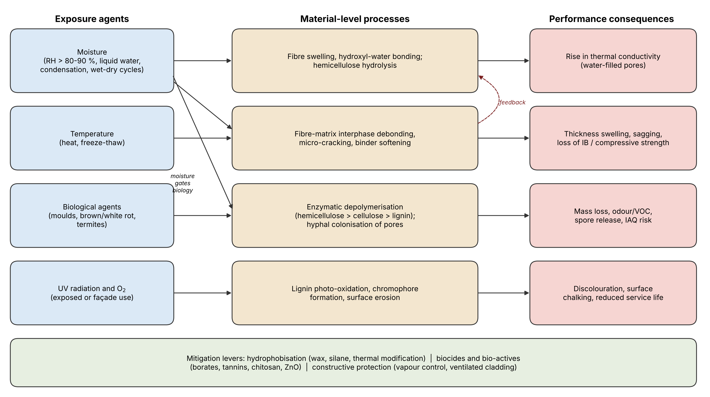
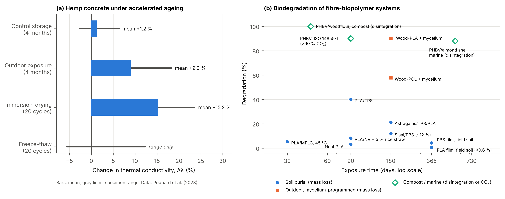
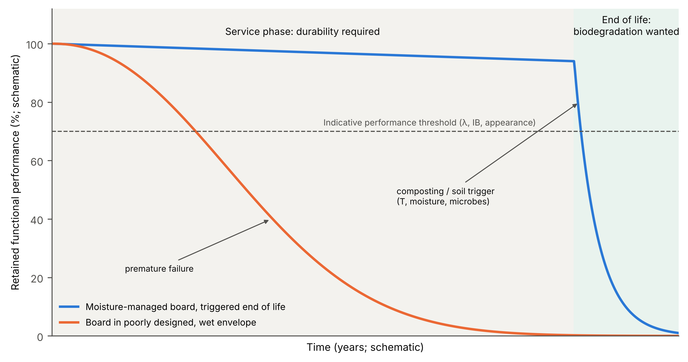

## 4.5 Durability and biodegradation

Natural fibre biocomposite insulation boards are expected to do two things that pull in opposite directions. During service, typically several decades in a building envelope, they must hold their thermal resistance, dimensions and integrity in conditions that occasionally favour microbial growth. At end of life, the same lignocellulosic chemistry that makes them renewable is presented as an advantage, because it allows composting, soil assimilation or energy recovery. This section treats that tension as a design variable rather than a contradiction. It first identifies moisture as the variable that gates almost every degradation route (Section 4.5.1), then reviews biological attack by moulds, decay fungi and termites (Section 4.5.2), physical and environmental ageing (Section 4.5.3), protective strategies and their environmental costs (Section 4.5.4), and finally intentional biodegradation and end-of-life routes (Section 4.5.5). Fig. 4.5-1 summarises the coupled pathways discussed throughout.

{width=100%}

**Fig. 4.5-1.** Coupled degradation pathways in natural fibre biocomposite insulation boards: exposure agents (left), material-level processes (centre) and performance consequences (right). Moisture acts as the gating variable for biological attack, and interphase damage feeds back into higher water uptake. Mitigation levers are listed at the bottom. *Original schematic prepared for this review; placement: end of the Section 4.5 introduction.*

### 4.5.1 Moisture as the governing variable

Most of the durability literature on bio-based insulation converges on a single point: degradation is rarely initiated by the fibre itself but by the moisture history the fibre experiences. Recent reviews describe moisture as the principal constraint on natural fibre-reinforced polymer composites in construction, because it swells fibres, weakens the fibre–matrix interphase and creates the conditions for fungal colonisation [1]. A comparative review of bio-based and conventional insulation reached a similar conclusion for mould, adding that laboratory protocols seldom reproduce real exposure and therefore make cross-material comparisons difficult [2]. The service-life literature for polymeric envelope materials adds a further caution, namely that climate change makes ageing loads less predictable and may shorten nominal service lives [3].

The time dimension of wetting appears to matter as much as its magnitude. In a stress test of 14 bio-based building materials under flooding, leaking-pipe and prolonged high relative humidity (RH) scenarios, Andersen and Rasmussen [4] reported mould on wood chip board after 6 days and indicated that growth could be avoided if the material dried within 3–5 days. Under the leaking-pipe scenario, grass, hemp and wood-fibre insulations became mouldy after roughly one week, whereas other materials remained free of growth for three months. Species composition also differed by substrate: *Stachybotrys chartarum* was isolated only from hemp-fibre insulation and hempcrete, while *Aspergillus* spp., *Chaetomium globosum* and *Trichoderma viride* occurred across most materials [4]. These observations suggest that a single static RH threshold is a poor descriptor of risk for porous, hygroscopic boards.

Pore structure and additives control how quickly that drying can occur. De Ligne et al. [5], combining X-ray computed tomography, infrared and low-field nuclear magnetic resonance (NMR) spectroscopy, showed that hydrophobic additives (paraffin, bitumen) and thermal modification dominated liquid water uptake and release of wood-fibre insulation and wood-based panels. Where no hydrophobic additive was present, porosity and the manufacturing process governed uptake, with more porous materials absorbing water faster. The authors argued that fit-for-purpose moisture performance is often preferable to biocidal protection, a position that recurs in Section 4.5.4.

Regulatory moisture limits for natural fibre insulation have also been questioned. Laboratory inoculation of wood-fibre insulation with decay fungi under different climates indicated that some products were as resistant as solid wood, or more so, while others were clearly less resistant [6], [7]. On this basis the authors proposed temperature- and duration-dependent limit curves in place of the widely used fixed limit of 20 % moisture by mass, and argued that uniform limits much lower than those for solid wood are not justified [7]. The practical implication is that durability classification of insulation boards should be product-specific rather than generic to "natural fibre" materials.

Field and in situ data confirm that bio-based boards can operate for long periods close to critical conditions. In internally insulated solid masonry walls monitored for 1 year and 9 months, diffusion-open bio-based systems remained above 80 % RH for extended periods. Even with hydrophobised masonry, the interface reached 95–100 % RH in winter [8]. Cellulose-insulated walls showed no mould at the interface (mycometer value below 25), whereas all four hemp-fibre mat walls showed growth (values above 400) [8]. A Danish house built with wood-fibre insulation and clay plaster without membranes performed well in the roof (RH below 70 %), although one floor sensor group reached 18 % moisture content on the cold side, and crawlspace ventilation was recommended [9]. Chamber tests at a constant 94.8 % RH and 22 °C classified hemp board and wood-shavings insulation as "very sensitive" on the Finnish mould growth scale, with hemp boards approaching 100 % mould coverage within three months regardless of clay coating [10]. Taken together, these studies indicate that envelope design and drying potential determine whether a board's intrinsic susceptibility ever becomes a service problem.

### 4.5.2 Biological durability: moulds, decay fungi and termites

Biological attack on insulation boards takes three forms with different consequences. Moulds are mainly an aesthetic and indoor air quality (IAQ) problem, decay fungi cause mass loss and structural failure, and termites cause rapid loss of material and can use the insulation as a pathway into adjacent timber. The chemical composition of the fibre influences all three. In Guyanese fibre-insulation boards produced from seven tropical wood residues, chemical composition and hygroscopic behaviour were related to fungal, mould and termite resistance, and the authors proposed a dedicated tropical test protocol because existing standards focus on European fungi and termites [11]. A companion study applied supervised machine learning with SHapley Additive exPlanations (SHAP) to ten panel types and identified the holocellulose-to-lignin ratio as the primary driver of mass loss. Higher ratios increased susceptibility, extractives and moisture content influenced resistance to *Pycnoporus sanguineus*, and panel density had minimal effect on termite damage [12]. This is one of the few data-driven attempts to rank compositional descriptors of durability, and it suggests that feedstock selection may be as effective as post-treatment.

Mould susceptibility varies widely among commercial and experimental insulants. Nunes et al. [13] found that expanded cork agglomerate was more susceptible to mould than expanded polystyrene (EPS) and mineral wool. All materials tested, including a wood/glass fibre composite, could be crossed by two subterranean termite species to reach wood. The wood/glass fibre composite nevertheless reduced termite survival and attack, and coconut fibre performed well against biological agents [13]. In straw-based insulation with thermal conductivity (λ) of 45–65 mW·m⁻¹·K⁻¹ at 60–100 kg·m⁻³, barley straw showed lower sorption and lower mould intensity than wheat straw [14]. Gypsum- and phosphogypsum-bound hemp shive composites (200–400 kg·m⁻³, λ = 0.058–0.101 W·m⁻¹·K⁻¹) had a pH of 5.60–6.55 that favoured rapid mould growth. *Cladosporium*, *Rhizopus* and *Chaetomium* appeared early, and the authors restricted the material to dry conditions [15]. Flax-fibre materials modified with caffeine, nano-copper or corundum were all colonised after one month at about 90 % RH and 25 °C, with copper-modified samples performing worst [16]. Animal-fibre systems are not exempt either: sheep wool composites with λ of 0.0324–0.0436 W·m⁻¹·K⁻¹ showed low resistance to microorganisms [17]. Among recycled cellulose-based insulants, incomplete desorption at low RH left residual moisture that could favour mould, and only relative resistance was achieved without intensified biocidal treatment [18].

Mycelium-bound insulation is a special case, because the binder is itself a fungus. Across nine fungal strains, λ ranged from 0.019 to 0.039 W·m⁻¹·K⁻¹ and water contact angles from 105° to 122°, yet mould colonisation ranged from 0 to 94 % of the surface depending on strain [19]. *Trametes versicolor* composites on hemp shives absorbed 600–880 % water and were all contaminated by *Rhizopus*, *Trichoderma* and *Acremonium* after full immersion. Adding birch bark reduced water absorption by more than 100 percentage points [20]. Strain selection therefore appears to be a first-order durability parameter for mycelium boards, comparable in importance to fibre selection in conventional boards.

Decay and termite data are more abundant for agro-residue particleboards than for low-density insulation boards, and these results are used here as a proxy. Particleboards containing macadamia carpel, papaya stalk or coffee husk (10–30 %) bonded with urea-formaldehyde (UF) were at best moderately resistant to brown rot (*Gloeophyllum trabeum*, syn. *Brunneoporus malicola*) and white rot (*T. versicolor*). Even the best formulation lost about 42–44 % of its mass. Resistance to drywood termites was good, but there was none against *Nasutitermes corniger* [21]. In eucalyptus–bagasse boards, higher bagasse content improved fungal resistance but eased termite access, and tannin adhesive increased termite mortality [22]. Sandwich panels with heat-treated pine faces resisted fungi best, while *N. corniger* caused more mass loss than drywood termites [23]. Bean straw–rubberwood boards proposed as insulants showed lower termite mass loss as straw content increased, but modulus of elasticity (MOE) and modulus of rupture (MOR) fell by 66.4 % and 52.5 % respectively [24]. Commercial structural particleboards reached a "resistant" classification, with 7.82–12.72 % mass loss to white rot and 14.69–16.55 % to brown rot. Solid *Pinus densiflora* and oriented strand board (OSB) exceeded 45 % [25]. These figures show that the adhesive system and particle size can shift durability class as strongly as the fibre species. They also show that termite and fungal resistance are not necessarily correlated. Table 4.5-1 consolidates the available data.

**Table 4.5-1.** Biological durability of natural fibre and bio-based insulation boards and related low-density agro-residue panels (2021–2026). *Placement: end of Section 4.5.2.*

| Material / board | Fibre or aggregate | Binder / matrix | Density (kg·m⁻³) / λ (W·m⁻¹·K⁻¹) | Protective treatment | Biological agent(s) | Exposure conditions and duration | Assessment method | Key quantitative outcome | Implication for insulation use | Ref. |
|---|---|---|---|---|---|---|---|---|---|---|
| 14 bio-based building materials incl. hemp, grass and wood-fibre insulation | Hemp, grass, wood fibre, wood chips | Various (commercial) | n.r. | None | Indoor moulds (*Aspergillus* spp., *S. chartarum*, *C. globosum*, *T. viride*) | Flooding, leaking-pipe and prolonged high-RH scenarios, up to 3 months | Visual and microbiological identification | Wood chip board mouldy after 6 d; hemp, grass and wood-fibre insulation mouldy after ~1 week (leaking pipe); growth avoided if dried within 3–5 d | Drying time, not peak RH alone, governs mould risk | [4] |
| Hemp-fibre mat and cellulose interior insulation | Hemp fibre, cellulose | Commercial | n.r. | Masonry hydrophobisation (some walls) | Naturally occurring mould | In situ, internally insulated solid masonry, 1 year 9 months | Mycometer at insulation–masonry interface | Cellulose: mycometer < 25 (no growth); all four hemp walls > 400; interface RH 95–100 % in winter | Product-specific risk under identical exposure | [8] |
| Hemp board, wood-shavings insulation, clay-coated variants | Hemp, wood shavings | Commercial; clay coating | n.r. | Clay surface layer | Naturally occurring mould | Chamber, 94.8 % RH, 22 °C, 5–9 months | Finnish (VTT) mould growth scale | Hemp board ~100 % coverage within 3 months with or without clay; classed "very sensitive" | Clay coatings do not confer mould resistance | [10] |
| Guyanese fibre-insulation boards (7 species) | Tropical sawmill residues | Wood-fibre board process | n.r. | None | Decay fungi, moulds, termites | Tropical laboratory protocol | Mass loss, mould rating | Resistance linked to chemical composition and hygroscopicity | Proposed tropical-specific test protocol | [11] |
| Fibre-insulation panels (10 types) | Sawmill residues, fast-growing and plantation wood | Wood-fibre board process | Density varied | None | *P. sanguineus*, *R. flavipes*, *C. dudleyi* | Controlled tropical conditions | Mass loss + ML regression with SHAP | Holocellulose/lignin ratio primary driver; density minimal effect on termite damage | Feedstock chemistry can be screened for durability | [12] |
| EPS, mineral wool, expanded cork, wood/glass fibre, coconut fibre | Cork, wood, coir | Various | n.r. | None | *A. niger*, *P. funiculosum*, *A. pullulans*; *R. grassei*, *R. flavipes* | Natural and artificial inoculation; termite exposure | Mould rating; termite survival and attack | Cork most mould-susceptible; all materials crossed by termites; wood/glass fibre reduced termite survival | No insulant is a termite barrier | [13] |
| Wheat and barley straw insulation | Wheat, barley straw | Loose / low-density | 60–100 / 0.045–0.065 | Boric acid | Moulds | Laboratory plus simulated wall climates | Mould growth intensity, hygrothermal simulation | Barley lower sorption and mould than wheat; boric acid improved resistance without λ penalty | Species selection plus borate for humid climates | [14] |
| Hemp shive biocomposite | Hemp shives | Gypsum / phosphogypsum | 200–400 / 0.058–0.101 | None | *Cladosporium*, *Rhizopus*, *Chaetomium* | High-humidity mould exposure | Mould development | pH 5.60–6.55 favoured rapid growth; phosphogypsum accelerated it | Restrict to dry conditions | [15] |
| Flax-fibre material | Flax | n.r. | n.r. | Caffeine, nano-Cu, corundum | Moulds | ~90 % RH, 25 °C, 1 month; fallout test | Mould intensity ranking | All samples infected; Cu least resistant; caffeine = corundum < Cu = control | Additive selection can worsen performance | [16] |
| Mycelium insulation (9 strains) | Lignocellulosic substrate | Fungal mycelium | n.r. / 0.019–0.039 | Deactivated contaminant propagules | Moulds | Laboratory contamination | Surface colonisation (%) | Colonisation 0–94 % depending on strain; contact angle 105–122° | Strain is a first-order durability variable | [19] |
| Mycelium composites | Hemp shives, birch sawdust | *T. versicolor* mycelium | n.r. | Birch bark, wheat bran additives | *Rhizopus*, *Trichoderma*, *Acremonium* | Full water immersion; 12 weeks compost | Contamination, water absorption | Water absorption 600–880 %; all samples contaminated after immersion | Immersion-sensitive; high compostability | [20] |
| Agro-waste particleboard | Macadamia carpel, papaya stalk, coffee husk (10–30 %) | UF, TUF | n.r. | None | *B. malicola*, *T. versicolor*; *C. brevis*, *N. corniger* | Standard decay and termite tests | Mass loss, termite mortality | Best case 42.28 % (UF) / 43.58 % (TUF) mass loss; up to 56.5 % termite mortality (*C. brevis*); no resistance to *N. corniger* | Agro-residues lower decay resistance | [21] |
| Eucalyptus–bagasse particleboard | Sugarcane bagasse (10–30 %) | Tannin, tannin–lignosulfonate | n.r. | None | *G. trabeum*, *T. versicolor*; drywood termites | 12 weeks (fungi), 45 d (termites) | Mass loss, termite survival | Bagasse improved fungal resistance but increased termite survival; 100 % tannin increased mortality | Fungal and termite resistance decoupled | [22] |
| Bean straw–rubberwood board | Bean straw, rubberwood | Castor-oil PU | n.r. | None | Drywood termites | Termite test | Mass loss; MOE, MOR | Lower termite mass loss with more straw; WA 11.44 → 7.68 %; MOE −66.4 %, MOR −52.5 % | Durability gain at mechanical cost | [24] |
| Structural particleboard (benchmark) | Wood particles | Commercial | n.r. | None | White and brown rot; termites | Standard laboratory tests | Mass loss, termite mortality | 7.82–12.72 % (white rot), 14.69–16.55 % (brown rot); *P. densiflora* and OSB > 45 %; 100 % termite mortality in 3 d | Reference values for board-scale decay | [25] |

*Abbreviations:* n.r., not reported in the source abstract; EPS, expanded polystyrene; ML, machine learning; OSB, oriented strand board; PU, polyurethane; RH, relative humidity; SHAP, SHapley Additive exPlanations; TUF, tannin–urea-formaldehyde; UF, urea-formaldehyde; WA, water absorption.

### 4.5.3 Physical and environmental ageing

Accelerated ageing studies on bio-aggregate insulation provide the clearest quantitative evidence of how λ drifts in service. In hemp concrete, Poupard et al. [26] reported mean λ changes of +1.22 % for control samples stored for four months, +9.0 % after four months outdoors, and +15.2 % after 20 immersion–drying cycles, with individual specimens reaching +23.6 %. Freeze–thaw cycling produced a scattered response (−5.6 % to +12.3 %). These data are plotted in Fig. 4.5-2a. Under a weathering protocol adapted from that for external thermal insulation composite systems (ETICS), a hemp-based cementitious mortar carbonated and developed quantifiable cracking at the shiv–cement interface. Its λ, moisture buffer value (MBV) and vapour permeability deteriorated only slightly [27]. Cycles of immersion, freezing and drying increased porosity of hemp concrete by about 6 % and produced interfacial cracks. Numerical simulation indicated about an 18 % difference in RH between aged and reference material, with corresponding shifts in sensible and latent heat flux [28]. Hemp and rapeseed concretes carbonated rapidly, and carbonation raised compressive strength only for mixes containing a viscosity-modifying agent [29]. The more severe end of the spectrum is illustrated by bamboo bio-concrete, which lost 60 % of its compressive strength and 73 % of its Young's modulus after 12 months of natural weathering despite a resin surface treatment [30].

{width=100%}

**Fig. 4.5-2.** (a) Change in thermal conductivity of hemp concrete after control storage, outdoor exposure, immersion–drying and freeze–thaw ageing (bars: mean; lines: specimen range), plotted from data in [26]. (b) Degradation versus exposure time for natural fibre–biopolymer systems compiled from [31], [32], [33], [34], [35], [36], [37], [38], [39], [40]. Filled markers denote mass loss, and open markers denote disintegration or CO₂ evolution, which are not strictly comparable with mass loss. *Placement: panel (a) in Section 4.5.3 and panel (b) cross-referenced in Section 4.5.5.*

For resin-bonded natural fibre composites, the interface is consistently identified as the weak link. Cyclic hygrothermal ageing of epoxy–flax composites (52 cycles over one year, alternating 90 % and 40 % RH every 3.5 days) reduced transverse tensile strength by about 20 % within the first week. Transverse modulus fell by about 18 % after one week and about 45 % after one year, which the authors attributed to fibre–fibre and fibre–matrix debonding and to cracks initiating at the fibre lumen rather than to chemical degradation of the matrix [41]. Flax–phenolic composites immersed for up to three years reached a Fickian equilibrium moisture content of 18.3 % within 64 days. They eventually lost 77.7 % of tensile strength and 47 % of Young's modulus, following a proposed sequence of swelling, debonding, matrix degradation and fibre degradation [42]. In a bio-based unsaturated polyester system reinforced with basalt fibre, water immersion before cycling caused most of the damage (−5 % to −39 %), while 300 subsequent freeze–thaw cycles had little additional effect [43]. Moisture saturation therefore appears to be the dominant ageing load, and freeze–thaw becomes damaging mainly once the pore system is already wet. This interpretation is consistent with the scattered freeze–thaw response reported for hemp concrete [26].

Low-density and mineral-bound boards show similar trends. Alkali-activated, cement-free agro-waste particle boards subjected to repeated wet–dry and freeze–thaw cycles absorbed more water, swelled more and lost flexural strength, although their thermal performance did not change significantly [44]. Lime-bound rapeseed straw and sunflower aggregates aged at 30 °C and 90 % RH were more vulnerable to fungi than bacteria. Lime had an immediate antimicrobial effect, yet λ and compressive strength had declined by three months [45]. Field evidence highlights a separate failure mode, namely workmanship. In ten timber-frame test walls exposed outdoors since 2015, construction defects caused local moisture increases, loose-fill insulation settled, and in one case the measured λ of wood-fibre insulation was almost double the manufacturer's design value [46]. By contrast, a hempcrete wall monitored in situ for about eight months in the Latvian climate showed consistently low mould risk, and a calibrated numerical model reproduced its hygrothermal response [47]. Replacement infill panels in historic timber-frame buildings, including wood fibre, cork and hempcrete, showed no interstitial condensation, and lime–hemp plaster finishes shortened drying [48]. Table 4.5-2 compares the ageing protocols and their outcomes.

**Table 4.5-2.** Physical and environmental ageing of bio-based insulation and natural fibre composites: protocols and property changes. *Placement: end of the second paragraph block of Section 4.5.3.*

| Material | Fibre / aggregate | Binder / matrix | Ageing protocol | Conditions | Duration / cycles | Change in λ | Mechanical change | Hygric or dimensional change | Dominant mechanism reported | Ref. |
|---|---|---|---|---|---|---|---|---|---|---|
| Hemp concrete | Hemp shiv | Lime-based | Control storage | Stable laboratory storage | 4 months | +1.22 % (−2.7 to +6.3 %) | n.r. | Minor | Negligible ageing | [26] |
| Hemp concrete | Hemp shiv | Lime-based | Natural outdoor exposure | Ambient climate | 4 months | +9.0 % (+2.7 to +18.3 %) | n.r. | Dimensional change measured | Weathering, moisture uptake | [26] |
| Hemp concrete | Hemp shiv | Lime-based | Immersion–drying | Water immersion then drying | 20 cycles | +15.2 % (+7.3 to +23.6 %) | n.r. | Dimensional change measured | Moisture cycling, microstructural change | [26] |
| Hemp concrete | Hemp shiv | Lime-based | Freeze–thaw | Freezing and thawing | 20 cycles | −5.6 to +12.3 % | n.r. | n.r. | Scattered response | [26] |
| Hemp-based mortar | Hemp shiv | Cementitious | ETICS-derived total weathering | Heat, rain, freeze cycles | Full protocol | Slight deterioration | n.r. | Slight change in MBV and vapour permeability | Carbonation; shiv–cement interface cracking | [27] |
| Hemp concrete | Hemp shiv | Lime-based | Immersion–freezing–drying | Combined cycles | n.r. | Simulated heat-flux shifts | n.r. | Porosity +~6 %; ~18 % RH difference (simulated) | Interfacial cracking | [28] |
| Hemp and rapeseed concrete | Hemp, rapeseed | Lime + VMA | Accelerated and outdoor carbonation | CO₂-enriched and ambient | Long-term | n.r. | Carbonation increased strength only with VMA | n.r. | Rapid carbonation of binder | [29] |
| Bamboo bio-concrete | Bamboo particles (50 vol%) | Cementitious; resin-treated particles | Natural weathering | Outdoor | 12 months | n.r. | Compressive strength −60 %; Young's modulus −73 % | Gloss loss | Particle–matrix degradation | [30] |
| UD epoxy–flax composite | Flax | Epoxy | Cyclic hygrothermal | 3.5 d at 90 % RH / 3.5 d at 40 % RH | 52 cycles (1 year) | n.a. | Transverse strength −20 % (1 week); transverse modulus −18 % (1 week), −45 % (1 year) | Reversible matrix plasticisation | Fibre–fibre and fibre–matrix debonding; lumen cracks | [41] |
| UD flax–phenolic composite | Flax | Phenolic | Water immersion | 23, 37.8 and 60 °C | Up to 3 years | n.a. | Tensile strength −77.7 %; modulus −47 %; shear strength ~−71.7 % | Mₘₐₓ 18.3 % (Fickian, 64 d) | Swelling → debonding → matrix → fibre degradation | [42] |
| Basalt / bio-based UP composite | Basalt | Bio-based unsaturated polyester | Immersion + wet freeze–thaw | 30 d at 20 °C; −20 °C (3 h) / 23 °C (8 h) | Up to 300 cycles | n.a. | −5 to −39 % (mostly from pre-immersion) | ILSS partially recovered (+12 %) | Water saturation dominates | [43] |
| Zero-cement agro-waste particle board | Agro-waste particles | Alkali-activated binder | Wet–dry and freeze–thaw | Repeated cycles | n.r. | No significant change | Flexural strength reduced | WA and TS increased | Binder and particle swelling | [44] |
| Lime-bound bio-aggregate composites | Rapeseed straw, sunflower bark and pith | Lime | Microbial ageing | 30 °C, 90 ± 3 % RH | 0, 3, 6, 12 months | Decreased after 3 months | Compressive strength decreased | n.r. | Fungal colonisation (fungi > bacteria) | [45] |
| Timber-frame walls with bio-based insulation | Wood fibre, loose-fill | Commercial | Natural field exposure | Outdoor test walls | Since 2015 | Measured λ up to ~2 × design value (one case) | n.r. | Settlement of loose-fill; local moisture rises | Workmanship defects | [46] |
| Hempcrete wall | Hemp shiv | Lime | In situ monitoring + simulation | Latvian climate | ~8 months | n.r. | n.r. | Low mould risk throughout | Validated hygrothermal model | [47] |
| Historic timber-frame infill panels | Wood fibre/wood wool, cork, hempcrete | Lime plasters | In situ monitoring | UK exposure, wind-driven rain | ≥ 2 years (planned) | n.r. | n.r. | No interstitial condensation | Render permeability controls drying | [48] |

*Abbreviations:* ETICS, external thermal insulation composite system; ILSS, interlaminar shear strength; Mₘₐₓ, maximum moisture content; MBV, moisture buffer value; n.a., not applicable; n.r., not reported in the source abstract; TS, thickness swelling; UD, unidirectional; UP, unsaturated polyester; VMA, viscosity-modifying agent; WA, water absorption.

A methodological gap is evident. The protocols in Table 4.5-2 differ in cycle length, temperature, saturation route and end-point property, so their results cannot be combined into a degradation-rate model. Durability prediction methods developed for polymer composites, such as rate models, time–temperature superposition and parametrised lifetime models under coupled environmental factors [49], have not yet been calibrated for low-density natural fibre boards. Doing so would require ageing data at several temperatures and RH levels for the same material, which is rarely reported.

### 4.5.4 Protective strategies and their environmental trade-offs

Protection strategies fall into four groups: (i) biocidal or bio-active additives, (ii) fibre and particle modification, (iii) hydrophobic treatments, and (iv) binder selection. Table 4.5-3 compares representative results. Borates remain the reference treatment for loose-fill and low-density cellulose insulation, but their efficacy depends on substrate accessibility. In loose-fill wheat straw, corn stalk and reed insulation treated with 8 % boric acid and 7 % tetraborate, thermo-mechanical pulping (TMP) or steam explosion pulping (SEP) limited mould to about 35–40 % of the inoculated area after 28 days at 28 °C and RH above 90 %. Raw crushed fibre with the same borate loading, and SEP fibre without fungicide, reached about 75 % [50]. Borates alone, in other words, did not suppress mould on nutrient-rich substrates. In straw insulation, boric acid improved mould resistance without measurably affecting hygric or thermal properties [14]. Boric acid has also been used as a fire retardant in hemp cellulose–silica xerogel insulation, which achieved λ = 31.3 mW·m⁻¹·K⁻¹, a contact angle of 115° and a flexural modulus of 665 MPa [51]. This points to dual-function fire and biological protection.

Hydrophobisation offers an alternative that attacks the root cause. Alkyl ketene dimer (AKD) treatment of mycelium and grass insulation significantly reduced water absorption and increased mould resistance while also improving thermal performance, and hygrothermal simulations favoured AKD-modified grass across climates [52]. Hydrophobic and flame-retardant coatings on sheep wool and hemp boards bonded with polylactic acid (PLA) bicomponent fibres (λ = 0.0333–0.0438 W·m⁻¹·K⁻¹) significantly reduced short-term water absorption from a range of 0.5–8.5 kg·m⁻² and reduced flammability [53]. At fibre level, 5 wt% NaOH and 5 wt% glycidoxypropyltrimethoxysilane (GPTMS) treatments reduced water uptake of hemp composites at room temperature from 7.74 % to 6.46 % and 5.58 % respectively. The treated composites nevertheless lost about 50–60 % of their stiffness once moist [54]. Hydrophobisation therefore slows uptake but does not remove the mechanical sensitivity of a saturated interface.

Thermal and chemical modification of particles improves biological resistance at a mechanical cost. Particleboards made from recycled thermally modified wood showed up to about 72 % lower 24 h thickness swelling, 64 % lower water absorption and up to 45 % better resistance to *Serpula lacrymans*. Mould resistance improved only in the first days of the test, and MOR and internal bond (IB) strength fell by up to 55.5 % and 46.2 % [55]. Bio-based esterification of rattan-skin particles with glycerol–citric acid reduced termite mass loss in a 98-day field test from about 28 % to below 8 % and raised the peak degradation temperature to 356.8 °C [56].

Alternatives to conventional biocides have been demonstrated mainly on solid wood, and their transfer to low-density boards remains to be shown. Silver nanoparticles combined with chitosan oligomers reduced white-rot mass loss of poplar from 41.96 % to 30.15 % and brown-rot mass loss from 41.93 % to 27.22 %. Termite survival fell from 53.98 % to 26.62 % [57]. Thyme essential oils were active in vitro against brown- and white-rot fungi [58]. Ammoniacal zinc borate protected wood against fungi and insects with lower leaching than other borate products [59]. In situ polymerisation of melamine formaldehyde (MF) resin around guanyl-urea phosphate and boric acid trapped the retardants and retained fire performance after leaching to EN 84 [60]. Formaldehyde-based fixation does, however, run counter to the low-emission rationale for bio-based boards.

Leaching and end-of-life fate are the main environmental trade-offs. Field application of a boron fertiliser recovered by pyrolysing borate-treated cellulose fibre insulation showed that 41–55 % of the applied boron leached below 16 cm. Leachate concentrations nevertheless stayed below the European Union drinking-water limit of 1 mg B·L⁻¹ [61]. This suggests a circular route for borate-treated insulation, provided application rates are controlled. Binder choice brings its own constraints. Tannin-bonded agro-forestry boards lost 11 % of their mass after three immersion cycles, and wood-fibre boards showed mass variations above 400 % during wet–dry cycling, so their use was restricted to dry interior applications [62]. Across the studies reviewed, no single treatment provides moisture resistance, biological resistance, low emissions and unimpaired end-of-life options at the same time. This supports the view that constructive protection (Fig. 4.5-1) should be the primary line of defence [5].

**Table 4.5-3.** Protective strategies for natural fibre insulation boards and related substrates: efficacy and trade-offs. *Placement: end of Section 4.5.4.*

| Strategy class | Agent / process | Substrate | Dose or process detail | Water-related effect | Biological effect | Effect on λ, mechanics or fire | Environmental or practical trade-off | Evidence level | Ref. |
|---|---|---|---|---|---|---|---|---|---|
| Biocide + pulping | Boric acid + tetraborate with TMP / SEP | Loose-fill wheat straw, corn stalk, reed | 8 % boric acid + 7 % tetraborate | n.r. | Mould coverage ~35–40 % (TMP/SEP) vs ~75 % (raw, untreated SEP) after 28 d, 28 °C, RH > 90 % | n.r. | Borates ineffective on nutrient-rich raw fibre | Insulation | [50] |
| Biocide | Boric acid | Wheat and barley straw insulation | n.r. | No adverse effect on hygric properties | Improved mould resistance | No adverse effect on λ | Borate leaching at end of life | Insulation | [14] |
| Fire retardant (boron) | Boric acid in silica xerogel | Recycled hemp cellulose insulation | n.r. | Contact angle 115° | n.r. | λ = 31.3 mW·m⁻¹·K⁻¹; flexural modulus 665 MPa; 30 % mass loss in 10 min burning | Dual fire/biological potential untested | Insulation | [51] |
| Hydrophobisation | Alkyl ketene dimer (AKD) | Mycelium and grass insulation | n.r. | Significant reduction in water absorption | Significantly higher mould resistance | Improved thermal performance | Long-term AKD stability under UV not reported | Insulation | [52] |
| Hydrophobic + FR coating | Commercial hydrophobic and flame-retardant agents | Sheep wool and hemp boards (PLA bicomponent fibre) | n.r. | Short-term WA reduced (range 0.5–8.5 kg·m⁻²) | n.r. | λ = 0.0333–0.0438 W·m⁻¹·K⁻¹; flammability reduced | Additional chemical load | Insulation | [53] |
| Fibre modification | 5 wt% NaOH; 5 wt% GPTMS silane | Hemp fibre composites | Immersion treatments | WA 7.74 → 6.46 % (NaOH), 5.58 % (silane) at RT | n.r. | Stiffness loss ~50 % (NaOH), ~60 % (silane) after moisture uptake | Interface remains moisture-sensitive | Composite | [54] |
| Thermal modification | Recycled thermally modified wood particles | UF particleboard | Substitution of untreated particles | TS (24 h) up to −72.3 %; WA up to −64 % | Resistance to *S. lacrymans* up to +45 %; mould benefit short-lived | MOR up to −55.5 %; IB up to −46.2 % | Mechanical penalty | Panel | [55] |
| Bio-based esterification | Glycerol–citric acid | Rattan-skin particleboard (PU) | 0, 20, 40 % Gly-CA | WA ~35–40 %; TS ~4–6 % (40 %) | Field termite mass loss ~28 % → < 8 % (98 d) | Tmax 356.8 °C; 20 % gives best strength balance | Bio-based, formaldehyde-free | Panel | [56] |
| Nano-biocide + biopolymer | Ag nanoparticles + chitosan oligomers | Poplar wood | 4 ppm Ag + 20 g·L⁻¹ COS, vacuum–pressure | n.r. | White rot 41.96 → 30.15 %; brown rot 41.93 → 27.22 %; termite survival 53.98 → 26.62 % | n.r. | Nanoparticle release and fate | Solid wood | [57] |
| Natural biocide | *Thymus* spp. essential oils | Wood products (in vitro) | Four chemotypes | n.r. | Active vs *T. versicolor*, *P. ostreatus*, *P. monticola*, *G. trabeum* | n.r. | Volatility, permanence in service unknown | In vitro | [58] |
| Low-leach borate | Ammoniacal zinc borate | Wood | Suspension in ammonia | n.r. | Effective vs *G. trabeum*, *T. versicolor*, *A. punctatum* | n.r. | Lower leaching than other borates | Solid wood | [59] |
| Fixation of retardant | GUP / boric acid + in situ MF resin | Scots pine | In situ polymerisation | Leaching strongly reduced after EN 84 | n.r. | LOI and cone calorimeter performance retained after leaching | Formaldehyde-based resin | Solid wood | [60] |
| Binder selection | Mimosa tannin vs UF | Corn cob, corn stalk, hemp shive, wood-fibre boards | n.r. | Wood-fibre boards > 400 % mass variation in wet–dry cycling | n.r. | n.r. | Tannin boards lost 11 % mass after 3 immersion cycles; dry interior use only | Low-density board | [62] |
| Constructive / moisture design | Paraffin, bitumen, thermal modification vs pore design | Wood-fibre insulation, wood-based panels | Product-inherent | Hydrophobic additives dominated uptake and release rates | Indirect (reduced wetting) | n.r. | Avoids biocides | Insulation | [5] |

*Abbreviations:* COS, chitosan oligomers; FR, flame retardant; Gly-CA, glycerol–citric acid; GPTMS, glycidoxypropyltrimethoxysilane; GUP, guanyl-urea phosphate; IB, internal bond strength; LOI, limiting oxygen index; MF, melamine formaldehyde; MOR, modulus of rupture; n.r., not reported in the source abstract; RT, room temperature; SEP, steam explosion pulping; TMP, thermo-mechanical pulping; TS, thickness swelling; UF, urea-formaldehyde; WA, water absorption.

### 4.5.5 Biodegradation and end-of-life pathways

Where the matrix is a biopolymer, biodegradability becomes a property to be engineered rather than avoided. The rate depends far more on the environment than on the composite formulation. PLA films buried in field soil at a mean temperature of 9.4 °C lost less than 0.6 % of their mass in one year, and a poly(butylene succinate) (PBS) film lost 4.3 % [31]. In contrast, PLA blended with thermoplastic starch (TPS) lost 40.06 % of its mass in 90 days of soil burial, with an estimated half-life of 103 days, because the starch phase was assimilated first [32]. Poly(3-hydroxybutyrate-co-3-hydroxyvalerate) (PHBV) biocomposites exceeded 90 % biodegradation after 90 days of thermophilic composting adapted from ISO 14855-1. Vermicomposting outpaced hydrolysis in freshwater [39]. For building products this distinction matters, because a PLA-bonded board that is stable in ambient conditions will not degrade in a landfill or garden soil within a useful time frame. It requires industrial composting.

Natural fibres can either accelerate or retard degradation of the matrix, and the published evidence shows both effects. Fibres accelerate degradation by introducing hydrophilic pathways, voids and accessible carbohydrates. Weight loss of wood–PLA composites increased from 3.2 % to 18.5 % as TPS content increased from 0 to 20 wt% [63]. *Astragalus* residue/TPS/PLA composites lost 21.40 % of their mass in 180 days, while flexural strength fell from 82.1 to 47.6 MPa [34]. In 90-day soil burial, a PLA/natural rubber blend containing 5 wt% rice straw lost 8.30 % of its mass, compared with 3.33 % for neat PLA. Visible fungal growth and a post-burial rise in crystallinity indicated preferential erosion of amorphous regions [35]. Cotton, wool and hemp all accelerated disintegration of poly(3-hydroxybutyrate-co-3-hydroxyhexanoate) (PHBH) in bioactive soil over 16 weeks, while wood fibre had the smallest effect [64]. Reed fibre in poly(butylene adipate-co-terephthalate) (PBAT) increased lipase-mediated weight loss from 5.63 % to 8.17 %. It also shortened the composting lag phase by 23.8 % and increased the biodegradation rate by 11.8 % [65]. In marine environments, PHBV/almond shell composites reached up to 88 % disintegration for thin films and reached 50 % mineralisation 55–70 % faster than neat PHBV [40]. Fibres retard degradation when they raise crystallinity, shield the matrix with lignin or bond well to it. Acetylation of microfibrillated lignocellulose in PLA reduced soil-burial weight loss relative to the untreated filler [33]. Lignin in woodflour slowed bioassimilation of PHBV by limiting access of enzymes and water [38]. Increasing lemongrass fibre content reduced the biodegradation rate of cassava starch composites [66]. The most informative mechanistic study shows that both effects can occur in the same system. Above the percolation threshold, hemp shives accelerated hydrolysis of PLA in water, whereas in mature compost the fibre-induced crystallinity protected the matrix and slowed degradation [67]. Enzymatic studies on jute/PLA describe a three-stage sequence (matrix chains, interface, then fibre) that is well described by Michaelis–Menten kinetics [68].

{width=100%}

**Fig. 4.5-3.** Conceptual durability–biodegradability design window. A moisture-managed board retains function through the service phase and degrades only once end-of-life conditions are imposed, whereas a board in a persistently wet envelope fails prematurely. The curves are schematic and do not represent measured data. *Placement: Section 4.5.5, after the paragraph on fibre effects.*

Durability and biodegradability need not be mutually exclusive. Sisal/PBS composites retained 62–69 % of their tensile strength and about 70 % of their flexural strength after 12 months of natural weathering, yet untreated-fibre composites lost about 12 % of their mass in six months of soil burial [36]. Mycelium composites grown on agricultural residues (110–250 kg·m⁻³, λ = 0.043–0.054 W·m⁻¹·K⁻¹) reached more than 46 % of theoretical oxygen demand in respirometric tests. The authors highlighted the trade-off between biodegradability and dimensional stability [69]. The concept of programmed lifetime has been pushed further with "living" wood–polymer composites, whose half-lives were tuned between about 53 days (wood–PLA) and 144 days (wood–polycaprolactone) through scaffold design and matrix selection [37]. These half-lives are far shorter than any building service life, but the approach points to triggered rather than spontaneous end-of-life degradation. Table 4.5-4 compares biodegradation studies, and Fig. 4.5-2b plots their mass-loss kinetics.

**Table 4.5-4.** Biodegradation of natural fibre biocomposites and bio-based insulation under different environments. *Placement: end of Section 4.5.5, before the end-of-life paragraph.*

| Matrix | Fibre / filler | Fibre content | Environment | Method / standard basis | Temperature | Duration | Mass loss or mineralisation | Property change | Effect of fibre on degradation | Ref. |
|---|---|---|---|---|---|---|---|---|---|---|
| PLA, PLA/PBAT, PBS (films) | Mineral filler | n.r. | Field soil | Natural burial | Mean 9.4 °C | 1 year | PLA < 0.6 %; PBS 4.3 % | Tensile strength −27.3 % (PLA_1), −5.8 % (PLA_2), +28.2 % (PBS_1) | n.a. (reference matrices) | [31] |
| PLA, PLA/PBSA, PLA/TPS | None (TPS phase) | n.a. | Soil | Laboratory burial | n.r. | 90 d | PLA/TPS 40.06 % (t½ ≈ 103 d) | Modulus −75.31 % (PLA/TPS, 21 d) | Starch phase assimilated first | [32] |
| PLA | Microfibrillated lignocellulose (plain, acetylated) | n.r. | Soil | Laboratory burial | 45 °C | 30 d | 5.4 % (MFLC); 4.2 % (PLA); 4.6 % (Ac-MFLC) | Storage modulus sharply reduced | Accelerates; acetylation retards | [33] |
| Wood/PLA/TPS (3D-printed) | Wood flour | TPS 0–20 wt% | Soil | Laboratory burial | n.r. | n.r. | 3.2 → 18.5 % with TPS 0 → 20 wt% | Crystallinity and Td increased after burial | Accelerates (via TPS) | [63] |
| PLA/TPS | *Astragalus* residue particles | 11/10/79 wt% | Soil | Laboratory burial | n.r. | 180 d | 21.40 % | Flexural strength 82.1 → 47.6 MPa; modulus 11,922 → 6,654 MPa | Accelerates | [34] |
| PLA/NR (60/40) | Rice straw | 3, 5 wt% | Soil | Laboratory burial (30 % soil moisture) | n.r. | 90 d | 8.30 % (5 wt% straw) vs 3.33 % (neat PLA) | Crystallinity increased | Accelerates | [35] |
| Cassava TPS | Lemongrass (*C. citratus*) fibre | 10–60 wt% | Soil | Laboratory burial | n.r. | n.r. | Reduced with higher fibre content | Max strength at 50 wt% | Retards | [66] |
| PHBV | Cellulose, woodflour | 15 % | Thermophilic compost | Disintegration + CO₂ evolution | 58 °C | 45 d (disintegration); < 60 d (mineralisation) | Complete disintegration | n.r. | Lignin retards bioassimilation | [38] |
| PHBV | ATBC, CaCO₃, lignin-coated CNC | n.r. | Compost, vermicompost, freshwater | ISO 14855-1 (adapted) | Thermophilic | 90 d | > 90 % biodegradation (compost) | n.r. | L-CNC slightly retards | [39] |
| PHBV | Cellulose, wood flour, almond shell | n.r. | Marine (port, open sea) + laboratory | Field disintegration + CO₂ mineralisation | Ambient seawater | 18 months | Up to 88 % (films), 33 % (sheets) | n.r. | Accelerates (50 % mineralisation 55–70 % sooner) | [40] |
| PHBH | Cotton, wool, wood, hemp | 30 mass% | Bioactive soil | Disintegration | n.r. | 16 weeks | n.r. (ranking only) | Mechanical properties reported | Accelerates (cotton, wool > hemp > wood) | [64] |
| PLA | Hemp shives | Across percolation threshold | Water; mature compost | Hydrolysis + compost | n.r. | n.r. | n.r. (kinetic study) | Crystallinity increased | Accelerates in water; retards in compost | [67] |
| PBAT | Reed fibre | n.r. | Enzyme solutions; controlled compost | Enzymatic + composting | n.r. | 15 d (enzyme); 91 d (compost) | Lipase: 5.63 % (PBAT) vs 8.17 % (PBAT/RF) | Lag phase −23.8 %; rate +11.8 % | Accelerates | [65] |
| PLA | Jute | n.r. | Enzyme cocktail | Protease K, cellulase, ligninase, pectinase | n.r. | 35 d | n.r. (Michaelis–Menten kinetics) | Three-stage degradation | Interface as second-stage target | [68] |
| PBS (bio-based) | Sisal (untreated, oxalic acid-treated) | n.r. | Outdoor weathering; soil | Natural exposure + burial | Ambient | 12 months (weathering); 6 months (soil) | ~12 % (untreated, soil) | Retained 62–69 % tensile and ~70 % flexural strength after weathering | Accelerates in soil | [36] |
| Mycelium (*G. resinaceum*) | Rose, lavender, wheat straw, pine sawdust | Substrate | Aerobic respirometry | Oxygen demand | n.r. | n.r. | > 46 % ThOD (rose/wheat straw 50:50) | λ = 0.043–0.054 W·m⁻¹·K⁻¹; 40–180 kPa at 10 % strain | Substrate-dependent | [69] |
| Wood–PLA, wood–PCL scaffolds + mycelium | Wood | n.r. | Ambient sun and rain | Outdoor exposure | Ambient | 180 d | Up to 90.31 % (wood–PLA), 57.77 % (wood–PCL) | Strength −77.61 % (PLA), −59.99 % (PCL) at 90 d; t½ 53.47 d / 143.94 d | Programmed via living mycelium | [37] |

*Abbreviations:* ATBC, acetyl tributyl citrate; CNC, cellulose nanocrystals; MFLC, microfibrillated lignocellulose; n.a., not applicable; n.r., not reported in the source abstract; NR, natural rubber; PBAT, poly(butylene adipate-co-terephthalate); PBS, poly(butylene succinate); PBSA, poly(butylene succinate-co-adipate); PCL, polycaprolactone; PHBH, poly(3-hydroxybutyrate-co-3-hydroxyhexanoate); PHBV, poly(3-hydroxybutyrate-co-3-hydroxyvalerate); PLA, polylactic acid; RF, reed fibre; t½, half-life; Td, decomposition temperature; ThOD, theoretical oxygen demand; TPS, thermoplastic starch.

At building scale, biodegradation is only one of several end-of-life routes, and it is not always the preferred one. Projections for France indicated that energy recovery from bio-based insulation waste up to 2050 could save 4.1 million m³ of landfill space, 75,000 t of fossil fuel and €89 million, and avoid 312,771 t CO₂-eq [70]. A review of wood and wood-fibre recycling in the United Kingdom favoured cascading recycled fibre into new insulation and panel products over bioenergy, because cascading prolongs carbon storage [71]. For the boards considered in this review, the implication is a hierarchy: design for long, dry service first, then for disassembly and fibre reuse, and only then for composting or energy recovery. Biodegradability is most valuable as a guarantee that leakage of the material into the environment is benign, not as the primary end-of-life route.

### 4.5.6 Synthesis and outlook for durability assessment

Three conclusions emerge from the evidence reviewed. First, moisture history, not fibre type, is the main predictor of durability, and the commonly applied fixed moisture limits appear conservative for some products and inadequate for others [7], [4]. Second, comparable quantitative data linking biological attack to changes in λ remain scarce. Existing standards such as ISO 846:2019 provide screening data but do not reproduce the cyclic hygrothermal loads that porous construction biocomposites experience in service [1]. Third, protection strategies trade off against each other: biocides against emissions and leaching, hydrophobisation against vapour openness, and thermal or chemical modification against mechanical strength. Table 4.5-5 lists the test methods most frequently used in the studies cited, together with their main limitations for insulation boards. Priorities for future work include harmonised ageing protocols that report λ, MBV and IB at the same time; decay tests calibrated for tropical fungi and termites [11]; predictive models that use compositional descriptors such as the holocellulose-to-lignin ratio [12]; and standardised end-of-life testing in which biodegradation is measured after realistic service ageing rather than on virgin material.

**Table 4.5-5.** Test methods commonly used to assess durability and biodegradation of bio-based insulation, with limitations for low-density boards. *Placement: end of Section 4.5.6.* Editions marked † should be confirmed against the current catalogue before submission.

| Method | Property assessed | Agent | Typical conditions | Duration | Output metric | Main limitation for insulation boards |
|---|---|---|---|---|---|---|
| EN 113-1:2020 | Resistance to wood-destroying basidiomycetes | Brown- and white-rot fungi (e.g., *C. puteana*, *G. trabeum*, *R. placenta*, *T. versicolor*) | Agar/soil culture, ~22 °C, ~70 % RH† | 16 weeks† | Mass loss (%) | Developed for solid wood; low-density boards lose mass to handling and leaching |
| ISO 846:2019 | Action of microorganisms on plastics | Fungi and bacteria | Methods A–D, inoculated incubation† | ~4 weeks† | Visual rating, mass and property change | Static conditions, no hygrothermal cycling [1] |
| ASTM D3273† | Mould resistance of surfaces in an environmental chamber | Mixed mould spores | ~32.5 °C, ~95 % RH† | 4 weeks† | Visual rating 0–10 | Surface-only, coating-oriented |
| ASTM C1338† | Fungal resistance of insulation materials and facings | Five mould species | ~30 °C, ~95 % RH† | 28 d† | Pass/fail vs. reference | Binary outcome, no kinetic information |
| EN 117† | Termite resistance (toxic values) | *Reticulitermes* spp. | Laboratory exposure† | 8 weeks† | Survival, attack grade | European species only [11] |
| EN 84:2020† | Accelerated ageing by leaching (pre-conditioning) | Water | Repeated water changes† | ~14 d† | Retained preservative or performance after leaching | Measures leachability, not service ageing |
| Finnish (VTT) mould growth model / mould index | Mould risk prediction and rating | Generic mould | Transient T and RH input | Any | Mould index 0–6 | Sensitivity classes require material-specific calibration [10] |
| ISO 14855-1:2012 | Ultimate aerobic biodegradability under controlled composting | Compost inoculum | ~58 °C† | Up to 6 months | CO₂ evolution (% of theoretical) | Industrial composting conditions only [39] |
| EN 13432† | Compostability of packaging (reference for biocomposites) | Compost | Thermophilic | 6 months (biodegradation), 12 weeks (disintegration)† | ≥ 90 % biodegradation | Packaging standard; not designed for thick boards |
| ISO 17556:2019† | Ultimate aerobic biodegradability in soil | Soil inoculum | 20–28 °C† | Up to 2 years† | O₂ demand or CO₂ evolution | Slow; ambient-soil results differ markedly from compost [31] |
| EN 12087† | Long-term water absorption by immersion of thermal insulation | Water | Total or partial immersion | 28 d† | kg·m⁻² or vol% | No drying phase, so wet–dry recovery is not captured |
| EN 12667† | Thermal resistance (guarded hot plate / heat flow meter) | n.a. | Steady state, controlled moisture | Hours | λ (W·m⁻¹·K⁻¹) | Usually measured only on dry, unaged specimens |

*Note:* Conditions and durations are indicative and given for orientation only. They are not cited from the studies in Tables 4.5-1 to 4.5-4. Confirm each standard's clauses before quoting them in the manuscript.

### References

[1] E. Stanaszek-Tomal, "Impact of biodeterioration on the structural and thermal insulation properties of plant fibre-reinforced polymer biocomposites for construction applications," *Materials*, 2026. [VERIFY vol., no., art. no., DOI]

[2] J. L. Wildman *et al.*, "Mould susceptibility of bio-based insulation materials in modern construction," *npj Mater. Degrad.*, vol. 10, no. 1, Art. no. 29, 2026. [VERIFY full author list, DOI]

[3] M. Riahinezhad, M. Hallman, and J.-F. Masson, "Critical review of polymeric building envelope materials: Degradation, durability and service life prediction," *Buildings*, vol. 11, no. 7, Art. no. 299, 2021, doi: 10.3390/buildings11070299.

[4] B. Andersen and T. V. Rasmussen, "Biobased building materials: Moisture characteristics and fungal susceptibility," *Build. Environ.*, vol. 275, Art. no. 112720, 2025, doi: 10.1016/j.buildenv.2025.112720.

[5] L. De Ligne *et al.*, "Moisture dynamics of wood-based panels and wood fibre insulation materials," *Front. Plant Sci.*, vol. 13, Art. no. 951175, 2022, doi: 10.3389/fpls.2022.951175.

[6] D. Zirkelbach *et al.*, "Evaluation of decay resistance of wood fibre insulation based on hygrothermal simulation and comparative laboratory tests," in *Proc. Int. Conf. Moisture in Buildings (ICMB21)*, 2021. [VERIFY authors, publisher, pages, DOI]

[7] E. Tanaka *et al.*, "Laboratory tests on decay of natural fibre insulation materials suggest a more differentiated evaluation and higher RH thresholds," 2023. [VERIFY venue (likely Nordic Symposium on Building Physics 2023 proceedings), pages, DOI]

[8] N. F. Jensen, E. B. Møller, K. K. Hansen, and C. Rode, "Hygrothermal assessment of three bio-based insulation systems for internal retrofitting solid masonry walls," *J. Build. Phys.*, vol. 48, no. 2, pp. 244–280, 2024. [VERIFY DOI]

[9] D. Bastien, M. Winther-Gaasvig, J. Z. Andersson, Z. Xiao, and H. Ge, "Hygrothermal performance of natural building materials: Simulations and field monitoring of a case study home made of wood fiber insulation and clay," *J. Build. Phys.*, vol. 47, no. 3, pp. 249–283, 2023, doi: 10.1177/17442591231195639.

[10] A.-M. Pessi *et al.*, "The addition of clay did not affect the mould susceptibility of two bio-based building materials," *J. Phys.: Conf. Ser.*, 2026. [VERIFY authors, vol., art. no., DOI]

[11] K. Candelier *et al.*, "Biological durability of Guyanese fibre-insulation boards in tropical context – Part 1: Relationships between chemical composition, water behaviour, and termite, fungal and mould resistances," *Wood Mater. Sci. Eng.*, 2025. [VERIFY vol., pages, DOI]

[12] C. Baudrit *et al.*, "Biological durability of Guyanese fibre insulation boards in tropical context – Part 2: Predicting fungal and termite resistance using explainable machine learning," *Wood Mater. Sci. Eng.*, 2025. [VERIFY vol., pages, DOI]

[13] L. Nunes, S. Duarte, J. L. Parracha, D. Jones, I. Paulmier, and M. Kutnik, "Insulation materials susceptibility to biological degradation agents: Molds and subterranean termites," *Appl. Sci.*, vol. 13, no. 20, Art. no. 11311, 2023, doi: 10.3390/app132011311.

[14] C. H. Koh, F. Gauvin, K. Schollbach, and H. J. H. Brouwers, "Upcycling wheat and barley straws into sustainable thermal insulation: Assessment and treatment for durability," *Resour. Conserv. Recycl.*, vol. 198, Art. no. 107161, 2023. [VERIFY DOI]

[15] G. Bumanis, I. Irbe, M. Sinka, and D. Bajare, "Biodeterioration of sustainable hemp shive biocomposite based on gypsum and phosphogypsum," *J. Nat. Fibers*, vol. 19, no. 15, pp. 10550–10563, 2022, doi: 10.1080/15440478.2021.1997871.

[16] K. Kobetičová *et al.*, "Resistance to molds of flax-fiber based materials," *J. Phys.: Conf. Ser.*, 2023. [VERIFY authors, vol., art. no., DOI]

[17] T.-O. Dénes *et al.*, "Analysis of sheep wool-based composites for building insulation," *Polymers*, vol. 14, no. 10, Art. no. 2109, 2022, doi: 10.3390/polym14102109.

[18] C. Petcu *et al.*, "Research on thermal insulation performance and impact on indoor air quality of cellulose-based thermal insulation materials," *Materials*, vol. 16, no. 15, Art. no. 5458, 2023, doi: 10.3390/ma16155458.

[19] J. Verhelst, S. Vandersanden, O. Nouwen, and F. Rineau, "Fungal strain influences thermal conductivity, hydrophobicity, color homogeneity, and mold contamination of mycelial composites," *Materials*, vol. 17, no. 24, Art. no. 6050, 2024, doi: 10.3390/ma17246050.

[20] I. Irbe, G. D. Loris, I. Filipova, L. Andze, and M. Skute, "Characterization of self-growing biomaterials made of fungal mycelium and various lignocellulose-containing ingredients," *Materials*, vol. 15, no. 21, Art. no. 7608, 2022, doi: 10.3390/ma15217608.

[21] F. G. Gonçalves *et al.*, "Resistance of particleboards produced with lignocellulosic agro-industrial wastes to fungi and termites," *Int. Biodeterior. Biodegrad.*, 2021. [VERIFY authors, vol., art. no., DOI]

[22] A. Almeida *et al.*, "Resistance of particleboards made from *Eucalyptus* sp. wood and sugarcane bagasse to xylophagous organisms," *J. Wood Chem. Technol.*, 2024. [VERIFY authors, vol., pages, DOI]

[23] J. B. Paes *et al.*, "Biological resistance of sandwich particleboard made with sugarcane, thermally-treated *Pinus* wood and malva fiber," *J. Wood Chem. Technol.*, 2022. [VERIFY authors, vol., pages, DOI]

[24] D. L. Faria *et al.*, "Particleboards based on agricultural and agroforestry wastes glued with vegetal polyurethane adhesive: An efficient and eco-friendly alternative," *Ind. Crops Prod.*, 2024. [VERIFY authors, vol., art. no., DOI]

[25] M. Lee, E.-C. Kang, S.-M. Lee, and S. Yoon, "Mechanical properties of structural particleboard and termite and decay resistance," *BioResources*, vol. 18, no. 3, pp. 6169–6182, 2023, doi: 10.15376/biores.18.3.6169-6182.

[26] T. Poupard, J. Tchiotsop, N. Issaadi, and O. Amiri, "Experimental study of the dimensional and hygrothermal properties of hemp concrete under accelerated aging," *Buildings*, vol. 13, no. 10, Art. no. 2414, 2023, doi: 10.3390/buildings13102414.

[27] D. Kosiachevskyi, K. Abahri, A. Daubresse, E. Prat, and M. Chaouche, "Assessment of the hygrothermal, microstructural and chemical evolution of a hemp-based cementitious mortar under ETICS total weathering aging protocol," *Constr. Build. Mater.*, vol. 314, Art. no. 125471, 2022, doi: 10.1016/j.conbuildmat.2021.125471.

[28] F. Benmahiddine, R. Belarbi, J. Berger, F. Bennai, and A. Tahakourt, "Accelerated aging effects on the hygrothermal behaviour of hemp concrete: Experimental and numerical investigations," *Energies*, vol. 14, no. 21, Art. no. 7005, 2021, doi: 10.3390/en14217005.

[29] S. Amziane, J. Sheridan, M. Sonebi, and S. Taylor, "An investigation into the long-term carbonation of vegetal concretes containing a viscosity modifying agent," *Constr. Build. Mater.*, vol. 296, Art. no. 123765, 2021, doi: 10.1016/j.conbuildmat.2021.123765.

[30] V. M. Andreola, N. P. Hasparyk, and R. D. Toledo Filho, "Effect of natural weathering on the mechanical strength of bamboo bio-concrete," *Buildings*, vol. 14, no. 11, Art. no. 3629, 2024, doi: 10.3390/buildings14113629.

[31] R. Ślężak, L. Krzystek, M. Puchalski, I. Krucińska, and A. Sitarski, "Degradation of bio-based film plastics in soil under natural conditions," *Sci. Total Environ.*, vol. 866, Art. no. 161401, 2023, doi: 10.1016/j.scitotenv.2023.161401.

[32] B. Palai, S. Mohanty, and S. K. Nayak, "A comparison on biodegradation behaviour of polylactic acid (PLA) based blown films by incorporating thermoplasticized starch (TPS) and poly (butylene succinate-co-adipate) (PBSA) biopolymer in soil," *J. Polym. Environ.*, vol. 29, pp. 2772–2788, 2021, doi: 10.1007/s10924-021-02055-z.

[33] F. Yetiş *et al.*, "Biodegradation of composites of polylactic acid and microfibrillated lignocellulose," *J. Polym. Environ.*, 2022, doi: 10.1007/s10924-022-02583-2. [VERIFY authors, vol., pages]

[34] Z.-B. Ni *et al.*, "FDM 3D printing and soil-burial-degradation behaviors of residue of *Astragalus* particles/thermoplastic starch/poly(lactic acid) biocomposites," *Polymers*, vol. 15, no. 10, Art. no. 2382, 2023, doi: 10.3390/polym15102382.

[35] C. Rong-or *et al.*, "Soil burial degradation of bio-composite films from poly(lactic acid), natural rubber, and rice straw," *Polym. Bull.*, 2024. [VERIFY authors, vol., pages, DOI]

[36] K. S. Kumar, M. Swamynaidu, C. Singh, and I. Singh, "Natural weathering and soil degradation characteristics of lignocellulosic sisal fiber based bio-PBS composites," *Int. J. Biol. Macromol.*, vol. 332, 2025. [VERIFY authors, art. no., DOI]

[37] D. Sharma *et al.*, "Living wood-polymer composites with tunable half-lives and enhanced performance," *Adv. Sustain. Syst.*, 2026, doi: 10.1002/adsu.202501446. [VERIFY authors, vol., art. no.]

[38] P. Feijoo *et al.*, "Effect of the presence of lignin from woodflour on the compostability of PHA-based biocomposites: Disintegration, biodegradation and microbial dynamics," *Polymers*, vol. 15, no. 11, Art. no. 2481, 2023, doi: 10.3390/polym15112481.

[39] P. Brdlík, M. Borůvka, L. Běhálek, and P. Lenfeld, "The influence of additives and environment on biodegradation of PHBV biocomposites," *Polymers*, vol. 14, no. 4, Art. no. 838, 2022, doi: 10.3390/polym14040838.

[40] P. Feijoo *et al.*, "Biodegradation of PHBV-based biocomposites in two different marine environments of the Mediterranean Sea," *Biodegradation*, vol. 37, no. 1, 2026, doi: 10.1007/s10532-025-10231-4. [VERIFY authors, art. no.]

[41] L. Van Schoors *et al.*, "Why cyclic hygrothermal ageing modifies the transverse mechanical properties of a unidirectional epoxy-flax fibres composite?," *Ind. Crops Prod.*, vol. 164, Art. no. 113341, 2021, doi: 10.1016/j.indcrop.2021.113341.

[42] M. Cai *et al.*, "Durable mechanical properties of unidirectional flax fiber/phenolic composites under hydrothermal aging," *Compos. Sci. Technol.*, vol. 220, Art. no. 109264, 2022. [VERIFY authors, DOI]

[43] A. T. Shahid, M. Hofmann, M. Garrido, J. R. Correia, and I. C. Rosa, "Freeze–thaw durability of basalt fibre reinforced bio-based unsaturated polyester composite," *Materials*, vol. 16, no. 15, Art. no. 5411, 2023, doi: 10.3390/ma16155411.

[44] A. Hatami Shirkouh, F. Meftahi, A. Soliman, S. Godbout, and J. Palacios, "Performance of eco-friendly zero-cement particle board under harsh environment," *Appl. Sci.*, vol. 14, no. 7, Art. no. 3118, 2024, doi: 10.3390/app14073118.

[45] M. El Hajjar *et al.*, "Assessing the durability of bio-based materials with respect to microbial contamination: Microstructure and macroscopic properties," *Case Stud. Constr. Mater.*, 2024. [VERIFY authors, vol., art. no., DOI]

[46] D. Michálková and P. Ďurica, "Experimental verification of thermal insulation in timber framed walls," *Materials*, vol. 15, no. 6, Art. no. 2040, 2022, doi: 10.3390/ma15062040.

[47] M. Birjukovs, M. Šinka, A. Jakovičs, and D. Bajāre, "Combined in situ and in silico validation of a material model for hempcrete," *Constr. Build. Mater.*, vol. 321, Art. no. 126051, 2022, doi: 10.1016/j.conbuildmat.2021.126051.

[48] C. J. Whitman, O. Prizeman, P. Walker, I. McCaig, and S. Rhee-Duverne, "Hygrothermal monitoring of replacement infill panels for historic timber-frame buildings: Initial findings," *UCL Open: Environ.*, vol. 4, 2022, doi: 10.14324/111.444/ucloe.000039. [VERIFY art. no.]

[49] O. Starkova, A. I. Gagani, C. W. Karl, I. B. C. M. Rocha, J. Burlakovs, and A. E. Krauklis, "Modelling of environmental ageing of polymers and polymer composites—Durability prediction methods," *Polymers*, vol. 14, no. 5, Art. no. 907, 2022, doi: 10.3390/polym14050907.

[50] R. Tupciauskas *et al.*, "Mold fungal resistance of loose-fill thermal insulation materials based on processed wheat straw, corn stalk and reed," *Polymers*, vol. 16, no. 4, Art. no. 562, 2024, doi: 10.3390/polym16040562.

[51] P. S. Jadhav, A. Sarkar, L. Zhu, and S. Ren, "Flame retardant biogenic building insulation materials from hemp fiber," *J. Appl. Polym. Sci.*, vol. 141, no. 12, Art. no. e55137, 2024, doi: 10.1002/app.55137.

[52] H. Song *et al.*, "Durability assessment of alkyl ketene dimer hydrophobic treatment of bio-based thermal insulation materials," *Resour. Conserv. Recycl.*, vol. 212, Art. no. 107983, 2025. [VERIFY authors, DOI]

[53] S. Vėjelis, S. Vaitkus, V. Skulskis, A. Kremensas, and A. Kairytė, "Performance evaluation of thermal insulation materials from sheep's wool and hemp fibres," *Materials*, vol. 17, no. 13, Art. no. 3339, 2024, doi: 10.3390/ma17133339.

[54] F. Bollino, V. Giannella, E. Armentani, and R. Sepe, "Mechanical behavior of chemically-treated hemp fibers reinforced composites subjected to moisture absorption," *J. Mater. Res. Technol.*, vol. 22, pp. 762–775, 2023, doi: 10.1016/j.jmrt.2022.11.152.

[55] J. Iždinský, Z. Vidholdová, and L. Reinprecht, "Particleboards from recycled thermally modified wood," *Forests*, vol. 12, no. 11, Art. no. 1462, 2021, doi: 10.3390/f12111462.

[56] M. Mubarok *et al.*, "Characteristics of particleboards made from esterified rattan skin particles with glycerol–citric acid: Physical, mechanical, chemical, and durability properties," *Polymers*, vol. 18, no. 1, Art. no. 107, 2026, doi: 10.3390/polym18010107.

[57] E. Spavento *et al.*, "Silver nanoparticles and chitosan oligomers composites as poplar wood protective treatments against wood-decay fungi and termites," *Forests*, vol. 14, no. 12, Art. no. 2316, 2023, doi: 10.3390/f14122316.

[58] A. M. Vettraino *et al.*, "Essential oils from *Thymus* spp. as natural biocide against common brown- and white-rot fungi in degradation of wood products: Antifungal activity evaluation by in vitro and FTIR analysis," *Eur. J. Wood Wood Prod.*, vol. 81, no. 3, 2023, doi: 10.1007/s00107-022-01914-3. [VERIFY vol., pages]

[59] C. M. Ibáñez *et al.*, "Ammoniacal zinc borate for wood protection against fungi and insects," *Forests*, vol. 14, no. 6, Art. no. 1152, 2023, doi: 10.3390/f14061152.

[60] C.-F. Lin *et al.*, "Approaching highly leaching-resistant fire-retardant wood by in situ polymerization with melamine formaldehyde resin," *ACS Omega*, vol. 6, no. 19, pp. 12733–12745, 2021, doi: 10.1021/acsomega.1c01044.

[61] O. Duboc *et al.*, "Field evaluation of a boron recycling fertiliser," *Plant Soil Environ.*, 2021. [VERIFY authors, vol., pages, DOI]

[62] L. Paulino *et al.*, "Performance of agro-forestry biomass particleboards bonded with tannin-based bio-adhesives," *Sustainability*, 2026. [VERIFY authors, vol., art. no., DOI]

[63] D. Lee, Y. Sun, W. Youe, J. Gwon, H. Cheng, and Q. Wu, "3D-printed wood-polylactic acid-thermoplastic starch composites: Performance features in relation to biodegradation treatment," *J. Appl. Polym. Sci.*, vol. 138, no. 36, 2021, doi: 10.1002/app.50914. [VERIFY art. no.]

[64] V. Röhl *et al.*, "Effect of different natural fibers on mechanical and disintegration properties of compostable biobased plastics," *J. Nat. Fibers*, vol. 20, no. 2, 2023, doi: 10.1080/15440478.2023.2248383. [VERIFY author order, art. no.]

[65] J. Xu *et al.*, "Enhanced biodegradation rate of poly(butylene adipate-co-terephthalate) composites using reed fiber," *Polymers*, vol. 16, no. 3, Art. no. 411, 2024, doi: 10.3390/polym16030411.

[66] Z. H. Kamaruddin, R. Jumaidin, R. A. Ilyas, M. Z. Selamat, R. H. Alamjuri, and F. A. Md Yusof, "Biocomposite of cassava starch-*Cymbopogan citratus* fibre: Mechanical, thermal and biodegradation properties," *Polymers*, vol. 14, no. 3, Art. no. 514, 2022, doi: 10.3390/polym14030514.

[67] L. Vitiello *et al.*, "Degradation kinetics of PLA/hemp biocomposites: Tradeoff between nucleating action and pro-hydrolytic effect of natural fibers," *Compos. Sci. Technol.*, vol. 257, Art. no. 110806, 2024, doi: 10.1016/j.compscitech.2024.110806.

[68] Z. Chen *et al.*, "Enzymatic degradation behaviors and kinetics of bio-degradable jute/poly (lactic acid) (PLA) composites," *Compos. Commun.*, 2022. [VERIFY authors, vol., art. no., DOI]

[69] G. Angelova *et al.*, "Mycelium-based composites derived from lignocellulosic residual by-products: An insight into their physico-mechanical properties and biodegradation profile," *Appl. Sci.*, vol. 15, no. 11, Art. no. 6333, 2025, doi: 10.3390/app15116333.

[70] C. Rabbat, S. Awad, A. Villot, D. Rollet, and Y. Andrès, "Sustainability of biomass-based insulation materials in buildings: Current status in France, end-of-life projections and energy recovery potentials," *Renew. Sustain. Energy Rev.*, vol. 156, Art. no. 111962, 2022, doi: 10.1016/j.rser.2021.111962.

[71] M. J. Spear, A. Dimitriou, S. F. Curling, and G. A. Ormondroyd, "Developments in the recycling of wood and wood fibre in the UK: A review," *Fibers*, vol. 13, no. 2, Art. no. 23, 2025, doi: 10.3390/fib13020023.
